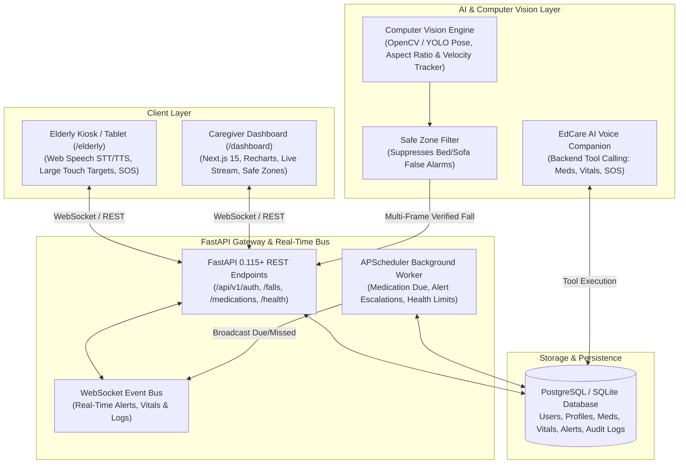

# EdCare — AI-Powered Elderly Care & Safety Monitoring Platform

[](https://opensource.org/licenses/MIT)
[](https://fastapi.tiangolo.com)
[](https://nextjs.org)
[](#)

---

## 🏷️ Topics & Tags

`elderly-care` • `fall-detection` • `computer-vision` • `ai-assistant` • `healthcare-ai` • `fastapi` • `nextjs-15` • `react` • `yolo-pose` • `opencv` • `websockets` • `apscheduler` • `smart-health` • `recharts` • `tailwind-css` • `edge-ai`

---

**EdCare** is a full-stack, production-ready AI elderly care assistant designed to empower seniors to live independently and safely at home while providing family caregivers with real-time health intelligence, multi-frame computer vision fall detection, proactive medication management, emergency escalations, and a conversational AI voice companion.

---

## 🏗️ System Architecture



---

## ✨ Key Features

### 1. 👁️ Computer Vision Fall Detection (Multi-Frame Verification)
- **Local Edge Processing**: Camera frames are processed locally without sending raw video to cloud servers, ensuring strict resident privacy.
- **Multi-Frame Temporal State Machine**: Rejects single-frame false positives (e.g., bending over or tying shoes). Evaluates:
  1. Downward velocity vector: $v_y = \frac{\Delta y}{\Delta t}$
  2. Aspect ratio deformation: Width / Height $\ge 0.95$ (vertical to horizontal flip)
  3. Floor proximity: Bounding box floor alignment
  4. Temporal verification window ($t \ge 2.5\text{s}$) before triggering emergency status
- **Safe Zone Filtering**: Interactive polygon boundaries (e.g., Bed, Sofa, Recliner) where resting is normal, suppressing false fall alerts.
- **Live Stream**: High-performance low-latency MJPEG video feed in caregiver dashboard.

### 2. 👵 Dedicated Accessible Elderly Interface (`/elderly`)
- **Accessibility-First Design**: 24px+ typography, high-contrast dark palette, large tap targets.
- **🚨 🆘 Emergency Button**: One-touch SOS with a 5-second countdown safety cancel window to prevent accidental clicks.
- **🎙️ EdCare AI Voice Companion**: Real-time Web Speech recognition and vocal synthesis. Answers: *"When is my next medicine?"*, *"What is my blood pressure?"*, or *"Call Sarah"*.
- **💊 Daily Medication Checklist**: Large dose tiles with instant "Mark Taken" feedback.
- **📞 One-Tap Family & Doctor Dialers**.

### 3. 👩‍⚕️ Caregiver Dashboard (`/dashboard`)
- **Live Monitoring**: Camera feeds with real-time bounding box HUD, detection stats, and simulation buttons (*Simulate Fall, Walk, Sit, Bed*).
- **Emergency Alerts Manager**: Workflow matching Section 9: `DETECTED` $\to$ `ACKNOWLEDGED` $\to$ `RESOLVED` / `FALSE_ALARM` / `ESCALATED`.
- **Medication Adherence**: Schedule generator, missed dose detection, and 7-day adherence scoring.
- **Health Vitals & Trends**: Interactive Recharts graphs for Heart Rate, Blood Pressure, SpO2, Temperature, Glucose, and Weight with Non-Diagnostic Safe Limits.
- **AI Tool Calling Console**: Audit inspector demonstrating tool execution (`get_medications`, `get_next_medication`, `get_health_records`, `trigger_emergency`).
- **Safe Zones Editor**: Interactive SVG/Polygon zone boundary designer.
- **Immutable Audit Trail**: Security log recording every caregiver action, acknowledgement, and system event.

### 4. 🧪 Interactive Demo Simulation Lab
- Toggleable simulation studio to safely demonstrate emergency fall detection, medication due notifications, abnormal vitals (126 bpm), and escalations without dangerous real-world situations.

---

## 🚀 Quickstart Guide

### Prerequisites
- **Python 3.12+** (tested on 3.13)
- **Node.js 20+** & npm

### 1. Backend Setup

```bash
# Activate virtual environment
.venv\Scripts\Activate.ps1   # Windows
# or: source .venv/bin/activate # Linux/macOS

# Install dependencies
pip install -r services/api/requirements.txt

# Run initial database seeding with demo caregiver, elderly patient, medications & vitals
python seed.py

# Start FastAPI server on port 8000
python -m uvicorn app.main:app --app-dir services/api --reload --port 8000
```

FastAPI Documentation is available at:
- **Interactive OpenAPI Swagger Docs**: [http://localhost:8000/docs](http://localhost:8000/docs)
- **ReDoc Documentation**: [http://localhost:8000/redoc](http://localhost:8000/redoc)

---

### 2. Frontend Setup (Next.js 15)

```bash
cd apps/web
npm install
npm run dev
```

Visit the application in your browser:
- **Landing Page**: [http://localhost:3000](http://localhost:3000)
- **Elderly Tablet Interface**: [http://localhost:3000/elderly](http://localhost:3000/elderly)
- **Caregiver Dashboard**: [http://localhost:3000/dashboard](http://localhost:3000/dashboard)
- **Sign In / Persona Switcher**: [http://localhost:3000/login](http://localhost:3000/login)

---

### 3. Running Standalone Vision Daemon (Optional)

```bash
python services/vision/run_vision.py
```

---

## 🔑 Demo Personas & Credentials

| Role | Email | Password | Full Name | Description |
| :--- | :--- | :--- | :--- | :--- |
| **Caregiver** | `caregiver@leocare.ai` | `password123` | Sarah Jenkins, RN | Primary caregiver & daughter |
| **Elderly User** | `elderly@leocare.ai` | `password123` | Muhammad Ali | Suite 102 (High Fall Risk) |
| **Admin** | `admin@leocare.ai` | `password123` | Chief Medical Admin | System administrator |

*(You can also click any of the 1-Click Persona cards on the `/login` page)*

---

## 🧪 Testing

Run the full automated test suite:

```bash
pytest -v tests
```

Tests cover:
- Authentication & JWT RBAC
- Medication adherence & daily log generation
- Health vitals recording & threshold violation triggers
- Emergency alert state machine (`DETECTED` $\to$ `ACKNOWLEDGED` $\to$ `RESOLVED`)
- AI conversational intent detection & tool execution
- Computer vision pose aspect ratio, floor proximity, safe zone suppression, and multi-frame fall verification

---

## 🐳 Docker Deployment

To launch the complete production stack (PostgreSQL, Redis, FastAPI Backend, Next.js Frontend) with a single command:

```bash
docker compose up --build
```

---

## 📄 License

This project is licensed under the terms of the [MIT License](LICENSE).

---

## 🔒 Healthcare & AI Safety Rules

1. **Non-Diagnostic Disclaimer**: The AI assistant and vitals monitors are for remote assistance and do not make clinical diagnoses or replace medical professionals.
2. **Multi-Frame Fall Assistance Notice**: Fall detection is an assistance feature. Emergency SOS button and family contacts are always prominently accessible.
3. **Privacy-First**: Video feeds are processed locally on device; only verified structured alert metadata is sent to the event bus.
